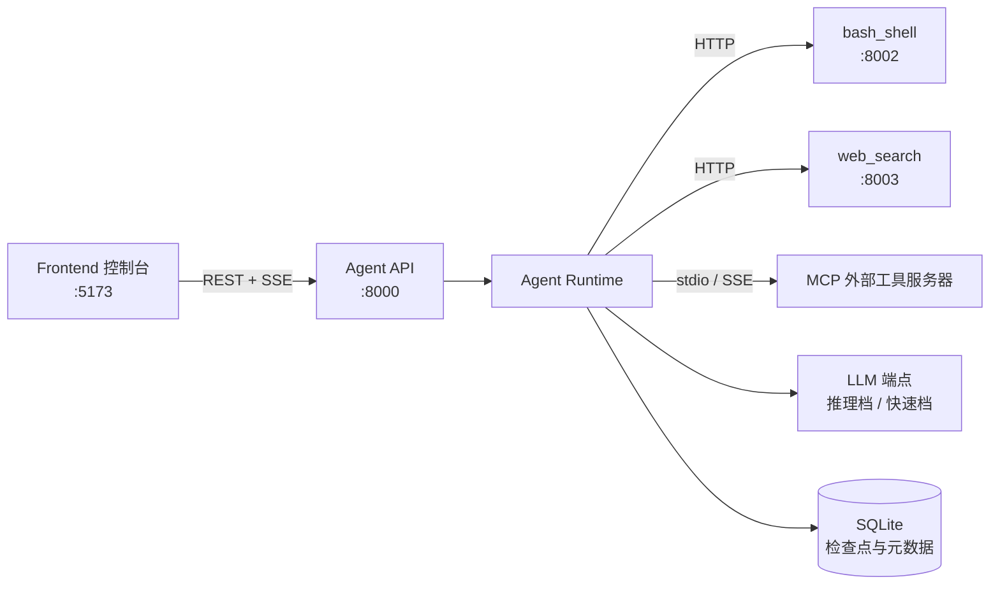

# 项目概览

## 1. 定位

BaseAgent 是一个运行在本机的**代码工程 Agent**：用户在浏览器控制台里给定一个目标和一个工作区目录，Agent 自主规划、调用工具（读写文件、执行命令、联网研究、委派子智能体），在受控的权限与预算内完成任务，并把全过程以事件流实时呈现给用户。

本文档集描述的是**自研 Agent Runtime 版本**，相对上一版有两处根本变化：

- **不依赖 LangGraph（及 LangChain）**：状态、主循环、检查点、人工审批挂起全部自研，消息类型也自定义。
- **不包含 RAG**：移除 AegisRAG 检索微服务及 `rag_search`、代码检索子智能体；代码定位改由 `bash`（grep/rg）和 `view_file` 完成。

设计取向：

| 取向 | 含义 |
|---|---|
| 确定性护栏优先 | 步数、Token、挂钟时间、连续错误、重复调用指纹，都是代码强制的硬上限，不靠提示词约束 |
| 最小权限 | 工具按只读 / 工作区写 / 全权限三级分级，越级操作必须经人工审批 |
| 不可信数据隔离 | 网页、第三方 MCP 输出视为不可信，外部信息只经研究子智能体以强类型报告回流 |
| 可恢复 | 任务状态持久化，进程崩溃、预算熔断、等待审批后都能续跑 |
| 本机优先 | 服务只监听回环地址，不面向公网 |

## 2. 范围

### 2.1 范围内

- **Agent Runtime**：任务状态模型、主循环、检查点与续跑、人工审批（HITL）、物理预算与循环检测、上下文装配与压缩、轨迹记录。
- **工具层**：内置工具（`bash`、`view_file`、`write_file`、`load_skill`）、MCP 外部工具、工具注册与派发。
- **子智能体**：联网研究子智能体、通用动态委派子智能体（能力与预算只降不升）。
- **独立服务（sidecar）**：`bash_shell` 沙箱执行、`web_search` 检索与正文抽取。
- **HTTP 接入层**：任务、会话、工作区、产物、文件等 REST 接口，以及 SSE 事件流。
- **前端控制台**：会话与工作区管理、对话与轨迹时间线、审批卡片、产物查看。
- **技能（Skill）与记忆**：技能包加载与信任分级；工作区 / 会话级记忆的持久化。
- **可观测性**：事件总线、轨迹落盘，可选的外部追踪。

### 2.2 范围外

- 向量检索、代码语义索引、重排序（随 RAG 一并移除）。
- 多用户、鉴权体系、远程部署与公网暴露。
- 多任务并发调度（当前约定单机串行，超出返回 429）。
- 通用工作流编排引擎：运行时只服务于 Agent 任务，不对外提供图编排能力。

### 2.3 待决事项

以下问题尚未定稿，定稿后写入 [12_decisions](../12_decisions/)，并回填本文：

- 主循环形态：保留 planner / executor / tool_runner / evaluator 分层，还是简化为单一 ReAct 循环。
- 人工审批的挂起方式：进程内等待，还是落盘后释放任务、由决策到达时重新拉起。
- 检查点的粒度与表结构。
- 去掉 LangChain 回调后，外部追踪如何接入。已决定：内部 span 模型加可插拔导出，见 [0004](../12_decisions/0004-tracing-model.md)（已采纳）。

## 3. 系统组成

Agent API 与 Runtime 同进程；`bash_shell` 与 `web_search` 是独立进程，只通过本机 HTTP 被调用，这条边界是有意保留的：执行命令和访问网络的能力不与编排逻辑共享地址空间。

## 4. 术语

| 术语 | 含义 |
|---|---|
| 工作区（Workspace） | 用户指定的目标工程目录。文件读写和命令执行都被限制在其中 |
| 会话（Session） | 一个工作区下的连续对话，承载会话级记忆 |
| 任务（Task） | 一次"目标 → 交付"的执行单元，有独立 `task_id`，是检查点与预算的计量单位 |
| 里程碑（Milestone） | 规划阶段把任务拆出的阶段目标，状态为 `pending` / `in_progress` / `completed` / `failed` |
| 状态（AgentState） | 任务执行的全部持久化状态：目标、里程碑、消息、预算计数、权限级别等 |
| 步（Step） | 一次"决策并执行工具"的循环迭代，计入 `step_count` |
| Planner | 负责宏观规划与重规划，产出里程碑与下一步指令（推理档模型） |
| Executor | 把指令转化为具体工具调用（快速档模型） |
| Tool Runner | 工具执行环节：权限判定、审批挂起、并发派发、观察值治理、预算冲销 |
| Evaluator | 复核里程碑是否达成，提炼摘要与事实，决定继续或交付 |
| Budget Guard | 每步前检查物理预算与循环信号，超限即熔断 |
| 物理预算 | 步数、累计 Token、挂钟时间三项确定性上限。刻意不使用费用口径 |
| 指纹（Fingerprint） | 对工具名与参数取哈希，连续重复达到阈值视为死循环 |
| 权限级别 | `read_only` / `workspace_write` / `full_permissions` 三级，任务有基线，越级操作触发审批 |
| HITL | Human-in-the-loop，人工审批。以 `approve` / `reject` 决策恢复被挂起的任务 |
| 观察值（Observation） | 工具返回给模型的结果。过长时头尾截断，全文落盘为产物 |
| 产物（Artifact） | 落盘的原始输出，以句柄引用，模型按需再读取 |
| 滚动摘要（Rolling Summary） | 对话压缩后保留的历史摘要 |
| 已确认事实 / 失败尝试 | 评估环节沉淀的正向事实与"禁区"结论，防止重复踩坑 |
| 金丝雀（Canary） | 注入提示词的随机标记，出现在不该出现的输出中即视为提示词泄露 |
| 注入防护 | 对工具输出与描述中的提示词注入特征做识别与隔离 |
| 检查点（Checkpoint） | 任务状态的持久化快照，用于崩溃恢复、审批续跑与预算熔断后的 `resume` |
| 研究子智能体 | 唯一的外部信息入口：隔离处理网页内容，只回流强类型研究报告 |
| 动态子智能体 | 主 Agent 临时派发的受限子劳动力，工具集、权限、预算在派发时一次性收窄，不可扩张 |
| 技能（Skill） | 以 `SKILL.md` 描述的可加载能力包。按内置 / 用户全局 / 工作区分级信任，工作区级默认拒绝 |
| MCP | Model Context Protocol。外部工具服务器经描述消毒、逐名授权后才进入工具表 |
| Sidecar | 与 Agent 同工程但独立进程的服务（`bash_shell`、`web_search`） |
| SSE | Server-Sent Events，向前端推送任务进度、工具调用与审批请求的事件流 |
| 推理档 / 快速档 | 两类模型配置：前者用于规划与复核，后者用于工具调度与摘要，各自带降级端点链 |

## 5. 阅读路线

1. 先读本文，建立整体印象。
2. [01_architecture](../01_architecture/) 看系统边界与数据流。
3. [02_runtime](../02_runtime/) 看运行时核心设计，这是自研改造的重点。
4. 其余按需：工具与服务、API、前端、测试、决策记录。
