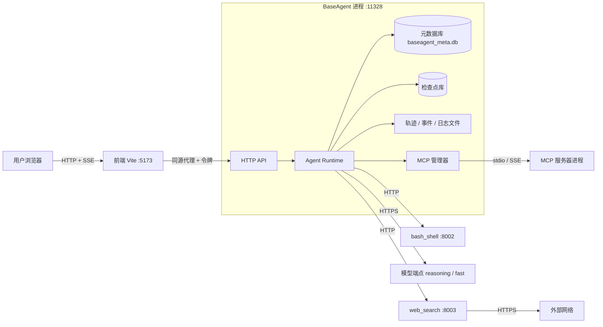

# 系统总览

## 1. 一句话

用户在浏览器控制台里给定工作区和目标，Agent 运行时在本机自主决策、调用工具、必要时请求人工审批，把进度实时推回控制台，并在受控的权限内完成任务。

## 2. 进程与端口



| 进程 | 端口 | 角色 | 生命周期 |
|---|---|---|---|
| 前端（Vite 开发服务器） | 5173 | 控制台界面；开发时也是 API 的同源代理 | 由统一启动器管理 |
| BaseAgent | 11328 | HTTP API 与运行时同进程 | 统一启动器管理 |
| `bash_shell` | 8002 | 命令执行沙箱 | 由 Agent 的监督器拉起，或复用已在运行的外部实例 |
| `web_search` | 8003 | 检索、抓取、清洗 | 同上 |
| MCP 服务器 | — | 第三方工具进程 | 懒加载，由 MCP 管理器拉起 |

### 2.1 为什么这样划分

| 边界 | 理由 |
|---|---|
| API 与运行时同进程 | 任务状态、事件缓冲、审批白名单都在内存里协作，拆开只会增加序列化与一致性成本 |
| 命令执行独立进程 | 执行任意命令的能力不与编排逻辑共享地址空间；命令崩溃、被 OOM、卡死不影响检查点与状态 |
| 网络抓取独立进程 | 同上，且让"哪个进程接触外部网络"一目了然，便于后续做网络隔离 |
| MCP 服务器独立进程 | 第三方代码，只能是独立进程，并受资源上限约束 |
| 模型调用在 Agent 进程内 | 经网关统一管理，不需要额外的进程边界 |

所有服务只监听回环地址，配置里写其他地址会在加载时被拒绝。

## 3. 存储

| 存储 | 位置 | 内容 | 写入方 |
|---|---|---|---|
| 元数据库 | `storage/baseagent_meta.db` | 工作区、会话、对话流水、会话记忆、工作区记忆 | 记忆管理器 |
| 检查点库 | `storage/checkpoints/…` | 每个任务最新的 `AgentState` 快照 | 主循环 |
| 事件库 | `storage/…/events.db` | 任务事件，供时间线与重放 | 任务注册表 |
| 轨迹 | `storage/traces/{task_id}.jsonl` | 每步因果记录 | 轨迹记录器 |
| 大块内容 | `storage/traces/{task_id}/llm/` | `llm.call` 的完整消息体 | 网关 |
| 产物 | `storage/artifacts/{task_id}/` | 被裁剪的观察值、命令全量日志、网页正文 | 裁剪器、沙箱、web_search |
| 日志 | `storage/logs/baseagent.jsonl` | 结构化运行日志 | Loguru |
| 令牌 | `storage/api_token` | API 访问令牌 | 启动流程 |

全部是本地文件，SQLite 使用 WAL。没有外部数据库依赖。

### 3.1 数据目录的锚定

系统通过 `BASEAGENT_HOME`（默认 `~/.local/share/baseagent`，可由环境变量或配置覆盖）作为数据根目录，所有存储相对路径均相对它解析，并在启动看板里打印实际路径。本地开发调试时可通过配置指向仓库内的 `storage/`。

## 4. 配置

完整说明见 [配置](04_configuration.md)，实际文件是仓库根的 `config/config.toml` 与 `.env.example`。

- 业务参数、配额、降级列表放 `config/config.toml`，可以进版本库。
- 密钥只通过 `.env` 提供，配置里只写环境变量名。
- 配置在加载时**强校验**，不合法直接拒绝启动（例如监听非回环地址、端点密钥缺失且为云端）。
- 配置文件里的敏感值（`env:VAR` 引用）在加载时解析一次，不写回。

分区：运行时护栏、重试、上下文治理、存储路径、模型分档、服务寻址、API 接入、MCP、`bash_shell`、`web_search`、研究、子智能体、技能、权限。各分区的含义见对应子系统文档。

## 5. 启动顺序

启动顺序即依赖顺序：

```
1. 日志                      （此后所有步骤都有日志）
2. 预检                      环境、存储可写、依赖可导入、配置合法
3. 拉起或复用 sidecar        bash_shell、web_search；探测健康，健康的外部实例直接复用
4. 装配进程级运行时          记忆库初始化 → 检查点库打开 → 模型网关 → 提示词库 → 技能 → MCP 管理器
5. 任务注册表
6. 恢复扫描（新版）           发现上次中断的任务：标记失败待续跑，或恢复为待审批
7. 打印启动看板              各依赖状态与实际数据目录
8. 开始接受请求
```

### 5.1 预检

在真正启动前检查：Python 版本与必需依赖、`storage` 可写、数据库可打开、配置里的路径存在、各档至少有一个可用端点。结果分 OK、警告、错误三级，错误则拒绝启动，警告则在看板里显示。

### 5.2 sidecar 的拉起

- 先探测，已有健康实例就复用（便于在独立终端调试 sidecar）。
- 否则以 `python -m services.xxx` 子进程启动，捕获输出并转发到统一日志，带标签着色。
- 等待就绪探针通过，超时不阻止 Agent 启动，只在看板里标为不可用，对应工具调用时才失败（降级运行）。
- **子进程环境**：监督器传给 sidecar 的是白名单环境，不是整份 `os.environ`，见 [沙箱 §5.1](../05_security/02_shell_sandbox.md)。

## 6. 关闭顺序

与启动逆序，避免"任务还在跑但连接已断"：

```
1. 停止接受新请求
2. 取消运行中的任务       状态停在最近的检查点，可续跑
3. 关闭 MCP 连接          回收子进程
4. 关闭检查点与元数据库
5. 停止托管的 sidecar     SIGTERM，宽限后 SIGKILL，不留孤儿进程与端口残留
```

挂起等待审批的任务不运行，关闭时无需取消，状态已在检查点里。

## 7. 统一启动器

`baseagent` 命令一键管理多个进程：

- 启动 BaseAgent 与前端，聚合输出并按进程打上带颜色的标签。
- 每个进程放在独立的进程组，退出时级联发 `SIGTERM`、超时后 `SIGKILL`，绝不残留孤儿进程。
- 提供 `status`（探测各端口健康）与 `stop`（一键安全关机）。
- 端口占用时给出清晰提示，不盲目杀进程。

## 8. 质量属性

| 属性 | 如何满足 |
|---|---|
| 安全 | 回环绑定、令牌、Host/Origin 闸门；权限分层；沙箱；信任隔离，见 [05_security](../05_security/) |
| 可恢复 | 回合边界检查点；挂起落盘；启动扫描，见 [02_runtime](../02_runtime/) |
| 可审计 | 轨迹含入参、事件持久化、span 关联，见 [08_observability](../08_observability/) |
| 有界 | 步数、Token、挂钟、子智能体账本、调用截止时间 |
| 降级 | 端点降级与熔断；sidecar 不可用只影响相应工具；压缩失败不阻断任务 |
| 可测试 | 循环内核只依赖四个可注入对象；网关可注入假模型；工具可注入假客户端 |
| 可替换 | 档位与能力声明解耦具体模型；工具集、装配器与导出器可插拔 |

## 9. 明确不做

多用户与账户体系；远程部署与公网暴露；分布式与高可用；向量检索与代码语义索引；通用工作流编排引擎。若将来需要其中任何一项，都应当作为新的部署形态重新设计，而不是在本架构上打补丁。
