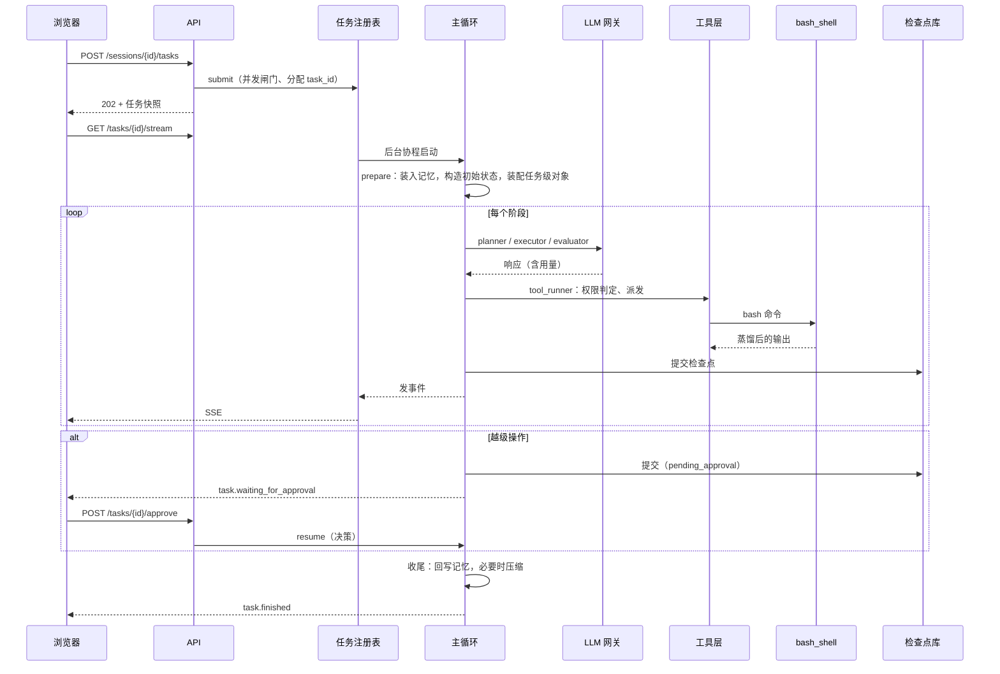

# 任务的端到端生命周期

把各子系统串起来，跟随一个任务从提交到交付，说明每一步由谁负责、写了什么、出错怎么办。

## 1. 全景时序



## 2. 阶段详解

### 2.1 提交

| 步骤 | 负责 | 要点 |
|---|---|---|
| 校验请求 | API | 会话存在，字段合法，目标长度上限 |
| 并发闸门 | 任务注册表 | 超过 `max_concurrent_tasks` 返回 429 |
| 分配 `task_id` | 任务注册表 | 先返回给客户端，客户端可立即订阅事件 |
| 权限基线 | API 与注册表 | 取请求值或会话配置；`full_permissions` 需显式确认 |

### 2.2 准备（Spawn）

每个任务**重建**任务级对象，因为它们的生命周期绑定单次任务：

```
记忆装入        工作区记忆、会话记忆、活跃对话轮次
初始状态        里程碑为空，物理度量归零，金丝雀由会话派生，任务目标作为最新的用户消息
预算守卫        新的挂钟起点
子智能体账本    与守卫同源的上限
观察值裁剪器    绑定产物目录
轨迹记录器      绑定 task_id
事件总线        之后绑定本轮的回调
工具注册表      内置工具 + 研究入口 + 动态委派 + 已授权的 MCP 工具
上下文装配器    分层提示词的静态视界
```

装配失败的部分降级，不拖垮任务：MCP 发现失败则跳过全部 MCP 工具；技能扫描失败则无技能清单。

### 2.3 主循环

见 [主循环](../02_runtime/02_main_loop.md)。简述：

```
planner ──► budget_guard ──► executor ──► tool_runner ──► planner …
   │                             │
   └──► evaluator ◄──────────────┘（无工具调用时）
```

每个阶段"状态进、增量出"，应用增量并计算下一跳后**提交检查点**，再发事件。

一次工具往返的内部顺序（`tool_runner`）：权限判定、必要时挂起；账本准入；死循环判定；派发前标记；并发派发；观察值裁剪与信封；错误计数；预算冲销。

### 2.4 挂起与恢复

越级操作使任务**落盘挂起并释放资源**，而不是在内存里等待。恢复由审批请求触发，从检查点重新进入 `tool_runner`，重新做同一次纯判定后消费决策。详见 [审批](../02_runtime/04_approval.md)。

### 2.4.1 任务运行器（已落地于 `agent_runtime.runtime`）

`TaskRunner` 是“任务注册表”中与运行相关的部分（HTTP 层的缓冲、事件表另算）：

- **提交** `submit(request)`：名额满则 `TaskQueueFullError`（对外 429 `TASK_QUEUE_FULL`），不登记、不落盘；否则分配 `task_id`、校验请求、**提交初始检查点**，再转入后台运行，立即返回。登记与名额检查之间没有 `await`，并发提交不会抢占同一个名额。
- **并发名额只统计 `running`**：挂起等待审批的任务释放名额；对它 `resume` 时需要空闲名额，没有则 `TaskQueueFullError`，任务保持原状。
- **续跑** `resume(task_id, decision)`：校验错误（缺决策、`approval_id` 不符、格式错误、已在运行）**同步抛给调用方**，任务原样不动；通过后转入后台。
- **状态映射**：`drive` 返回挂起 → `waiting_for_approval`（非终态，不发 finished）；成功 → `succeeded`；`should_terminate` → `terminated`（原因取 `termination_reason`）；任何异常 → `failed`（原因 `异常类型: 消息`，状态停在上一次提交点，可续跑）；用户取消 → `cancelled`。
- **取消** `cancel(task_id)`：运行中的任务被中断，挂起的任务作废其请求；两种都把“用户取消”的终态**落盘**——`should_terminate` 加原因“用户取消”，补齐未配对的工具调用（“未执行：任务已被用户取消”），清掉待审批请求、决策与派发标记。所以重启后它既不会被当成“进程中断”，也不会被当成“等待审批”。已结束的任务返回 `False`。
- **关停** `shutdown()`：停止运行中的任务，但**不写终态**，状态停在上一次提交点，下次启动可续跑。
- **启动接管** `adopt(RecoveryReport)`：中断的任务记为 `failed`（原因“进程中断”，不自动续跑），挂起的恢复为 `waiting_for_approval`。
- **收尾**：`TaskObserver.task_finished` 在状态定下之后调用，出错只记日志，不改变任务结果。
- **配置装配** `budget_limits_from_settings`、`max_concurrent_tasks`、`resolve_permission_level`：权限基线取请求值或 `runtime.approval.default_level`；`full_permissions` 需要显式确认（`require_full_permissions_confirm` 可关），基线被配成 `full_permissions` 时同样不能绕过确认。

已知局限：任务状态目前只在进程内存里；取消后的任务在存储层表现为“`should_terminate` 的终态”，因此**可被 `resume` 当作熔断任务续跑**（原因栏写着“用户取消”）。是否禁止、以及持久化的任务元数据表（`GET /sessions/{id}/tasks` 需要它），留给 API 层。

### 2.5 终止

| 终态 | 触发 |
|---|---|
| `succeeded` | 评估通过，或规划阶段直接答复 |
| `terminated` | 步数、Token、挂钟任一耗尽，或金丝雀熔断 |
| `failed` | 不可恢复异常（如全部模型端点不可用） |
| `cancelled` | 用户取消 |

`terminated` 和 `failed` 可续跑。

### 2.6 收尾（Teardown）

非挂起的终态都会：

1. 取出面向用户的交付（最后一条助手消息，结构化结论渲染成 Markdown），**脱敏金丝雀**；
2. 写会话流水（用户目标加交付），更新 `last_action_target`；
3. 沉淀本任务的事实与失败尝试到会话记忆（新版），见 [记忆 §5](../03_context/04_memory.md)；
4. 判断是否触发会话压缩（新版改为异步）；
5. 写 `final` 轨迹记录；
6. 关闭 sidecar 客户端；
7. 发 `task.finished`，关闭事件流。

收尾中任何一步失败都**不使已完成的任务变成失败**，只记录错误。

## 3. 数据在各处的形态

同一件事在不同位置有不同形态，各有各的生命周期：

| 信息 | 状态 | 检查点 | 轨迹 | 事件 | 会话记忆 |
|---|---|---|---|---|---|
| 用户目标 | `task_goal`、首条用户消息 | 是 | `final` | `task.started` | 流水 |
| 工具调用与结果 | `messages` | 是 | `tool`，含入参 | `tool.call` / `tool.result` | 否 |
| 被裁剪的完整输出 | `artifacts` 句柄 | 句柄 | 句柄 | 句柄 | 否 |
| 模型思考内容 | 助手消息的 `reasoning` | 近期部分 | 截断摘要 | 截断摘要 | 否 |
| 最终交付 | 最后助手消息 | 是 | `final` | `task.finished` | 流水 |
| 本任务确认的事实 | `confirmed_facts` | 是 | — | — | 沉淀后进入 |
| 网页正文 | **不存在**（隔离区内用完即弃） | 否 | 否 | 否 | 否 |

## 4. 失败路径速查

| 失败 | 发生位置 | 处理 | 任务结果 |
|---|---|---|---|
| 模型端点全部不可用 | 网关 | 降级链耗尽，抛异常 | `failed`，原因"LLM 不可用"，可续跑 |
| 单次调用超过截止时间 | 网关 | 放弃该调用 | `terminated`（预算耗尽） |
| 工具业务失败 | 工具层 | 失败观察值回给模型 | 继续，计入连续错误 |
| 连续错误达阈值 / 参数重复 | `tool_runner` | 注入重规划通知；整批拦截 | 继续 |
| 物理预算耗尽 | `budget_guard` | 置位终止 | `terminated`，可续跑 |
| 越级操作 | `tool_runner` | 挂起 | `waiting_for_approval` |
| 审批被拒绝 | `tool_runner` | 合成拒绝观察值 | 继续，要求改用合规方案 |
| 金丝雀泄露 | 循环层 | 立即终止，不执行本次响应里的工具 | `terminated` |
| sidecar 不可达 | 工具层 | 失败观察值 | 继续 |
| 进程崩溃 | 任意 | 重启后扫描检查点 | 标记失败，等待用户续跑 |
| 检查点写入失败 | 主循环 | 视为任务失败，不带着未持久化的进度继续 | `failed` |
| 事件、轨迹、追踪写入失败 | 旁路 | 只告警 | 不影响 |

## 5. 并发模型

- 默认同一时刻一个任务（`max_concurrent_tasks = 1`），串行化资源。
- 任务内：同一批工具调用并发派发；子智能体在 `tool_runner` 内部并发运行；网关对每个端点有并发上限。
- 全部是单个事件循环内的协程，预留（`reserve`）等需要原子的操作靠"内部无 `await`"保证。
- 阻塞 I/O（文件、分词、正文提取）进线程池，不阻塞事件循环。
- 取消通过 `asyncio` 取消传播，各处的清理放在 `finally` 且不含可被取消的 `await`。

## 6. 一致性边界

| 一致性问题 | 保证 |
|---|---|
| 状态与检查点 | 每个阶段原子提交；崩溃后从最近提交点重做该阶段 |
| 事件与检查点 | 先提交，后发事件 |
| 工具副作用与检查点 | 派发前打标记；崩溃后对可能已执行的非幂等调用合成"结果未知"，不盲目重放 |
| 预算与实际消耗 | 用量以服务商返回为准；账本预留保证并发不超额 |
| 记忆与任务结果 | 任务结果优先，记忆回写失败不影响结果 |

## 7. 待定

- 多任务并发（`max_concurrent_tasks > 1`）下，对同一工作区的并发写入如何协调。目前不支持，并发上限默认 1。
- 任务之间的依赖（`parent_task_id` 已有字段但未被运行时使用）。
