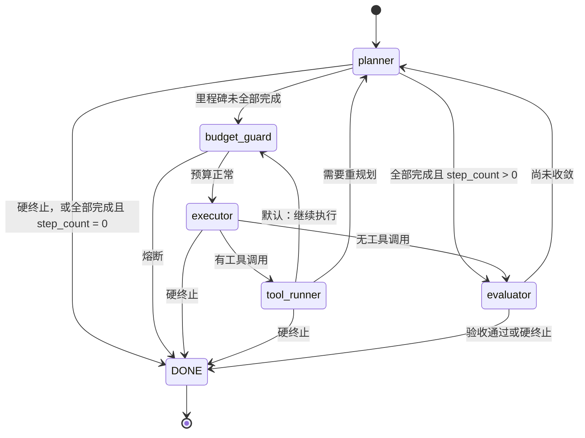

# 主循环

## 1. 五个阶段

| 阶段 | 职责 | 模型档 | 产出 |
|---|---|---|---|
| `planner` | 宏观规划与重规划，给出里程碑和下一步指令 | 推理档 | 里程碑、指令消息、Token |
| `budget_guard` | 硬熔断检查与软告警 | 无 | `should_terminate` 或告警消息 |
| `executor` | 把指令转成具体工具调用 | 快速档 | 带 `tool_calls` 的 assistant 消息，或直接答复；步数加一 |
| `tool_runner` | 权限闸门、并发派发、观察值治理、预算冲销 | 无 | 配对 tool 消息、错误计数、指纹、产物 |
| `evaluator` | 复核里程碑、提炼摘要与事实、决定继续或交付 | 推理档 | 里程碑状态、摘要、事实、失败尝试 |

阶段函数的统一签名：

```python
Stage = Callable[[AgentState], Awaitable[StageUpdate]]
```

输入只读，输出是增量字典，规则见 [状态模型 §3](01_state_model.md)。任务级依赖（模型网关、工具注册表、守卫、裁剪器、记录器、事件总线）通过闭包注入，每个任务构造一次。

## 2. 路由

下一个阶段完全由当前阶段结束后的状态决定，路由函数是纯函数，保持现有 `edges/after_*.py` 的逻辑，仅把 LangGraph 的 `END` 换成自有哨兵 `DONE`。



路由表：

```python
ROUTES: Mapping[Phase, Router] = {
    "planner":      route_after_planner,       # budget_guard | evaluator | DONE
    "budget_guard": route_after_budget_guard,  # executor | DONE
    "executor":     route_after_executor,      # tool_runner | evaluator | DONE
    "tool_runner":  route_after_tool_runner,   # budget_guard | planner | DONE
    "evaluator":    route_after_evaluator,     # planner | DONE
}
```

几条语义要保留：

- **空里程碑视为未完成。** 单步任务不能因为"没有计划"就跳过执行。
- **`step_count == 0` 且里程碑全部完成** 表示 planner 已直接答复，无需复核，直接交付。
- **executor 没有产生工具调用** 说明它给出了自然语言结论，转 evaluator 验收，而不是回 planner。
- 任一阶段置位 `should_terminate`，下一跳一律是 `DONE`。
- **工具批次之后默认直接继续执行**（`budget_guard → executor`），不回 planner。`tool_runner` 在状态里置 `replan_needed` 才回 planner：
  - 连续执行满 `[runtime.loop] replan_interval` 个批次（默认 6；0 表示每批都回，即旧行为）；
  - 连续失败达到阈值、指纹循环或摆动（ABAB…）被拦截；
  - 有调用被人工拒绝。

  planner 运行时清零 `replan_needed` 与 `steps_since_plan`。这样每个工具步不再多付一次推理档的结构化调用，规划只发生在开头、遇阻和定期复核时。executor 给出自然语言结论仍转 evaluator 验收。

## 3. 循环骨架

```python
async def drive(rt: TaskRuntime, state: AgentState) -> TaskOutcome:
    phase = state["phase"]
    while True:
        stage = rt.stages[phase]
        try:
            update = await stage(state)
        except ApprovalRequired as req:
            state = apply_update(state, {"pending_approval": req.payload, "phase": phase})
            await rt.checkpoints.commit(state)
            await rt.emit(approval_requested_event(req.payload))
            return TaskOutcome(state, approval_request=req.payload)

        state = apply_update(state, update)
        nxt = ROUTES[phase](state)
        state = apply_update(state, {"phase": nxt})
        check_invariants(state)                      # 原子对等；不满足即实现缺陷，不写检查点

        await rt.checkpoints.commit(state)          # 提交点
        await rt.emit_stage_events(phase, update, state)
        if nxt == DONE:
            return TaskOutcome(state)
        phase = nxt
```

要点：

1. **先提交，后发事件。** 事件反映的是已经落盘的事实，客户端看到的进度不会比可恢复的进度更远。
2. **`ApprovalRequired` 不是错误。** 它是阶段函数向循环请求挂起的信号，不携带增量，该阶段的任何局部结果都不被应用。因此阶段在抛出之前不得产生外部副作用，见 [审批](04_approval.md)。
3. **异常策略。** 阶段内的其他异常向上传播到任务运行器，任务标记 `failed`，状态停留在上一次提交点，仍可由 `resume` 续跑。LLM 全链路不可用属于预期内的失败：阶段返回 `should_terminate=True` 和原因，而不是抛出。
4. **取消。** 外层 `asyncio.Task` 被取消时，`CancelledError` 向上传播，状态同样停留在上一次提交点。

### 3.1 实现细节（已落地于 `agent_runtime.loop`）

- 路由在 `routes.py`：五个纯函数加 `ROUTES` 与 `ALLOWED_TRANSITIONS`（文档状态图的边）。测试用性质检验断言：任意状态、任意阶段，路由只会走图里画出的边；`should_terminate` 在每个阶段都路由到 `DONE`。
- 依赖通过 `TaskRuntime(stages, checkpoints, events)` 注入。`checkpoints` 只需要 `commit(state)`，`events` 是 `EventSink`（`stage_committed`、`approval_requested`）。构造时检查五个阶段齐全。
- **阶段函数不得写 `phase`**，返回的增量里带 `phase` 直接报 `InvalidUpdateError`：`phase` 的唯一写入者是主循环。`pending_approval` 允许阶段清空（消费决策时）。
- `drive` 返回 `TaskOutcome(state, approval_request)`，`status` 为 `succeeded`、`terminated` 或 `waiting_for_approval`；`failed` 与 `cancelled` 以异常传出，由任务运行器映射。
- 事件发送失败只记日志、不影响任务（状态已落盘）；`CancelledError` 不被吞掉。
- 提交失败向上传播，**此后不再发事件、不再运行下一阶段**。
- `drive` 对已处于 `done` 的状态什么也不做，也不提交。
- **文档原先的缺口：** 伪代码在提交前断言“所有工具调用已配对”，但 executor 提交时调用刚产出、tool_runner 还没执行，会误报。实现里把“最后一组允许暂无配对”的条件定为：`pending_approval` 非空，**或** `phase == "tool_runner"`。更早的组，以及其他阶段，仍必须完整。
- `drive` 本身没有迭代上限：防止死循环靠 `budget_guard`（步数/Token/挂钟）。若 `budget_guard` 或路由有缺陷，循环可能不终止；测试里用有限脚本避免，以后接真实阶段时要有总超时兜底。

### 3.2 模型阶段的失败

planner 与 evaluator 遇到模型不可用、截止时间不足、请求被拒时**返回终止增量而不抛异常**，细节与旧版差异见 [planner 与 evaluator](05_planner_evaluator.md)。

## 4. 终止与对外状态

| 终态 | 条件 |
|---|---|
| `succeeded` | evaluator 判定里程碑全部达成，或 planner 直接答复交付 |
| `terminated` | 步数、Token 或挂钟时间任一触达上限 |
| `failed` | 不可恢复异常，例如 LLM 全链路不可用 |
| `cancelled` | 客户端主动取消 |
| `waiting_for_approval` | 非终态，`pending_approval` 非空 |

`terminated` 与 `failed` 可经 `resume` 回到 `running`。`TaskStatus` 的完整迁移图沿用 `state.py` 现有定义。

## 5. 守卫如何嵌入

| 守卫 | 位置 | 作用 |
|---|---|---|
| 物理预算 | `budget_guard` 阶段 | 步数、Token、挂钟三项硬熔断；达到 90% 注入软告警消息 |
| 重复指纹 | `tool_runner` 内 | 对（工具名，参数）取哈希，连续相同达阈值则拦截整批并注入重规划通知 |
| 连续错误 | `tool_runner` 内 | 失败累加、成功清零；达阈值注入重规划通知并置 `replan_needed` |
| 摆动 | `tool_runner` 内 | 最近的指纹在两个取值间来回交替（`alternation_cycles` 个周期，默认 3）视同循环，拦截整批 |
| 终止时的交付 | 事件与会话记忆 | 被终止的任务（预算、验收上限、规划失效、循环）由代码根据状态生成部分交付：已完成/未完成的里程碑、已修改的文件、已确认的事实、最近进展；安全类终止不展开内容 |
| 权限闸门 | `tool_runner` 内，派发之前 | 越级则请求挂起 |
| 子智能体预算账本 | `tool_runner` 内 | 派发前同步父级用量并串行准入；派发后把子智能体的实际消耗以增量并入 `total_tokens` |
| 观察值裁剪 | `tool_runner` 内 | 超限输出头尾截断，全文落盘为产物 |

### 5.1 物理预算守卫（已落地）

`guardrails.PhysicalBudgetGuard` 与 `loop.stages.make_budget_guard_stage`，配置 `runtime.guardrails`：

| 维度 | 取值来自 | 熔断条件 | 软告警 |
|---|---|---|---|
| 步数 | `state.step_count`（executor 每轮加一） | `>= max_steps` | `>= max_steps × warning_ratio` |
| Token | `state.total_tokens`（含子智能体与研究的并入量） | `>= max_total_tokens` | 同上 |
| 挂钟 | 守卫实例自己的计时 | `>= max_wall_time_sec` | 同上 |

- **触达上限即熔断**（`>=`）：步数上限 25 表示最多做 25 步，第 25 步之后、第 26 步之前停。已熔断的维度不再同时算告警。
- **熔断**：增量为 `should_terminate = True` 加 `termination_reason`（如“步数达到上限（25/25）”，多项同时触达用“；”连接）；此时不再追加告警消息。路由因此一律到 `DONE`。
- **软告警**：追加**一条** `user` 角色的消息，写明各维度已用/上限并请模型收敛。每个维度**只告警一次**：上下文是追加式的，反复提醒既无新信息，又会让每轮多一条消息、破坏前缀缓存。同一次判定里多项同时越线合并成一条。
- **守卫随任务重建**：挂钟起点与“已告警”集合都不入状态，续跑时重置。因此续跑后挂钟重新计时、告警可再发一次，而 `step_count` 与 `total_tokens` 沿用——上限不变时可能立刻再次熔断（已测）。
- `remaining_wall_sec()` 供网关计算单次调用的截止时间；守卫只在阶段之间判定，**不会打断一次正在进行的模型调用**，那是网关截止时间的职责。
- 守卫保证了 `drive` 的终止：只要 executor 每轮增加步数，最迟在 `max_steps` 轮后必然熔断（已用“永远不收敛的任务”测试）。**前提是 executor 确实增加了 `step_count`**；这一点要在真实 executor 的测试里再次断言。

`tool_runner` 的执行顺序固定，不可调换：

1. 读取最近一条 assistant 的 `tool_calls`。
2. 权限闸门：逐项判定，存在未获豁免的越级时，要么消费已到达的审批决策，要么抛出 `ApprovalRequired`。
3. 同步账本并串行准入，必须在并发派发之前，否则并发子任务会各自读到同一份余额。准入完成后、派发之前，额外提交一次带 `dispatch_started` 的检查点，用于崩溃恢复（见 [检查点](03_checkpoint_and_resume.md) §5）。这是循环里唯一一次阶段中途的提交，由 `tool_runner` 通过注入的提交回调完成。
4. 指纹登记与死循环判定。
5. 并发派发，被拒绝或被拦截的调用不派发，改为合成失败观察值。
6. 观察值治理与配对 tool 消息组装。
7. 连续错误更新与重规划通知。
8. 预算冲销。

> 上面的执行顺序已按本节落地，细节与实现取舍见 [executor 与 tool_runner](06_executor_tool_runner.md)。第 3 步（账本）暂未实现，等子智能体。

旧版"冲销必须晚于审批闸门"的约束源自 `interrupt()` 会丢弃节点局部结果。本版挂起发生在第 2 步且不应用任何增量，约束依然成立但不再有隐蔽陷阱：挂起时尚未记账，也无需记账。

## 6. 事件

循环在提交之后按阶段发出事件，取代旧版对流式增量的事后解析。事件名与载荷以 [HTTP API 与 SSE 契约](../09_api/) 为准，此处只列循环负责发出的类型：

| 事件 | 发出时机 |
|---|---|
| `plan` | planner 提交后，带里程碑与指令 |
| `tool.call` | executor 提交后，每个工具调用一条 |
| `tool.result` | tool_runner 提交后，每条 tool 消息一条（结果截断） |
| `node.finished` | 每个阶段提交后一条，含步数、累计 Token、是否终止 |
| `task.waiting_for_approval` | 挂起检查点提交后 |

叶子工具（研究与动态子智能体）的内部进度经任务级事件总线推送。总线在 `drive` 开始前绑定本轮的事件回调，结束或挂起时解绑，这一点沿用现有做法。

## 7. 入口

```python
async def run_task(deps, req) -> TaskOutcome:       # 新任务
async def resume_task(deps, task_id, decision=None) # 续跑 / 提交审批决策
```

两者共同步骤：装配任务级运行时 → 取得状态（新建或从检查点加载）→ `drive` → 若非挂起则做收尾（回写会话记忆）→ 关闭 sidecar 客户端。细节见 [检查点与续跑](03_checkpoint_and_resume.md)。
