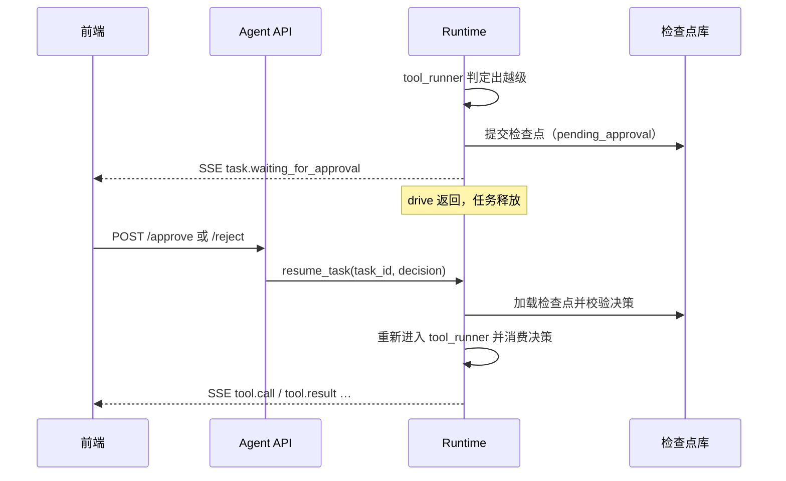

# 人工审批（HITL）

## 1. 权限模型

任务有一个基线权限级别，工具调用按所需级别判定：

| 级别 | 含义 |
|---|---|
| `read_only` | 只读工具 |
| `workspace_write` | 工作区内写文件、构建、测试等 |
| `full_permissions` | 联网外联、依赖安装、`git push`、提权、容器操作等 |

判定由 `check_permission(current_level, tool_name, args, permissions_config)` 完成，是**纯函数**：同样的输入永远得到同样的结论。它返回的判定包含 `allowed`、`required_level`、`current_level`、`action_type`、`action_summary`、`reason`。未知工具（典型如第三方 MCP）按 `unknown_tool_level` 保守处理，默认需要最高级别。分类表与命令正则在 `config.toml` 的 `[permissions]` 段。

需要审批的就是 `allowed == False`、且不在会话白名单里的调用，称为**越级操作**。

## 2. 为什么挂起要落盘

旧版用 `interrupt()` 挂起，恢复时**整个节点从头重跑**。所以必须把审批放在一个只做纯判定的节点，否则重跑会重复调用 LLM，甚至出现"批准的命令不等于实际执行的命令"。

本版挂起发生在阶段函数的开头，且该阶段在抛出 `ApprovalRequired` 之前不产生任何外部副作用：

1. 读取状态，做纯判定。
2. 有越级且无可用决策 → 抛出 `ApprovalRequired`。循环不应用增量，只记录 `pending_approval` 并提交检查点，随后任务退出循环、释放执行资源。
3. 决策到达后，续跑从检查点重新进入 `tool_runner`，**重新做同一次纯判定**，得到相同的越级集合，再消费决策。

assistant 的 `tool_calls` 已经在状态里，不会被重新生成，所以被批准的就是将被执行的。

## 3. 请求载荷

```json
{
  "approval_id": "appr_<确定性摘要>",
  "call_ids": ["call_1", "call_2"],
  "required_level": "full_permissions",
  "current_level": "workspace_write",
  "action_type": "network",
  "command": "curl https://example.com/x.sh",
  "reason": "命中网络外联模式",
  "escalation_count": 2,
  "related_actions": ["pip install requests"]
}
```

- `command` 与 `reason` 来自第一个越级项，`related_actions` 最多列出其后的 4 项，`escalation_count` 给出总数。
- **`approval_id` 是确定性的**：由 `task_id`、`step_count` 与越级 `call_ids` 排序后哈希得到，取前若干位。旧版用随机 UUID。确定性带来两点好处：崩溃后重新进入同一阶段会生成同一个请求，前端已展示的卡片仍然有效；决策可以精确绑定到这一批调用。
- `call_ids` 记录该次审批覆盖的调用，决策只对这一批生效。

## 4. 决策

```json
{ "approval_id": "appr_…", "approved": true,  "scope": "once" | "always", "reason": "" }
{ "approval_id": "appr_…", "approved": false, "reason": "不允许联网" }
```

校验在 `bind_decision` 里完成，任何一项失败都拒绝并保持任务仍处挂起：

- 任务确实处于等待审批，且 `pending_approval` 非空。
- `approval_id` 与待审批请求一致。
- `scope` 只允许 `once` 或 `always`，缺省视为 `once`。
- `approved` 必须是布尔值，`reject` 的 `reason` 可空，空则用默认文案。

`approval_id` 的计算：`sha256(JSON[task_id, step_count, 排序后的 call_ids])` 取前 16 位十六进制，前缀 `appr_`；用 JSON 编码，字段边界无歧义。实现见 `agent_runtime.approval`（`compute_approval_id`、`parse_decision`、`bind_decision`、`check_binding`）。

重复提交同一决策：第一次消费之后 `pending_approval` 已清空，第二次因任务不再等待审批而被拒绝，不会重复生效。

## 5. 消费决策

`tool_runner` 入口：

```python
escalations = [判定为越级且签名不在白名单的调用]
if escalations:
    decision = state["approval_decision"]
    if decision is None:
        raise ApprovalRequired(build_payload(state, escalations))
    check_binding(decision, state["pending_approval"], escalations)  # approval_id、call_ids 吻合
    blocked = apply_decision(decision, escalations, allowlist)        # 见下
    # 本次更新附带 pending_approval = None, approval_decision = None
```

`apply_decision`：

| 决策 | 结果 |
|---|---|
| 批准，`once` | 这批越级调用本次可执行 |
| 批准，`always` | 可执行，并把 `action_signature(name, args)` 加入会话白名单，之后相同操作免审 |
| 拒绝 | 这批越级调用不派发，为每一个合成失败观察值：`已被人工审核拒绝：<原因>，请改用合规方案（如仅生成本地补丁而不推送远端）` |

没有越级的同批调用不受影响，照常派发。所有调用无论结果如何都产生配对的 `tool` 消息，原子对不变量不被破坏。

决策被消费的同时，该次审批与结果写入轨迹（`record_type="guard"`），包含 `approval_id`、`approved`、`scope`、`reason`。

### 5.1 实现细节

`loop` 与 `approval` 是同层模块、不能互相导入，所以 `tool_runner` 通过注入的 `ApprovalHooks` 调用 `compute_approval_id` 与 `check_binding`，由装配层（`runtime.APPROVAL_HOOKS`）接上。越级集合为空时，残留的 `pending_approval` / `approval_decision` 视为过期并清掉。载荷的 `required_level` 取越级项里最高的。详见 [executor 与 tool_runner](06_executor_tool_runner.md)。

## 6. 会话白名单

- 白名单是 `action_signature` 的集合，按会话隔离，由任务注册表持有，通过引用传给 `tool_runner`。
- 不入检查点：进程重启即清空，随后同类操作会重新询问。这是有意偏安全的取舍。
- `always` 只对**完全相同的签名**生效，签名的构造规则决定了范围是否合理（例如是否包含参数全文）。该函数沿用现有实现，本版不改动，但需要在 [安全文档](../05_security/) 里写清楚它的粒度。

## 7. 子智能体与审批

子智能体**从不请求审批**：

- 越级即失败，以失败观察值回给父级，不挂起。
- 子智能体运行在 `tool_runner` 内部，若允许它挂起，就会让一个已经开始派发的阶段中途抛出，破坏"挂起前无副作用"的前提。
- 权限在派发前一次性收窄，子级权限不超过父级基线。父级权限级别由任务授权窗口推送给叶子工具。

## 8. 挂起期间的任务生命周期

| 方面 | 行为 |
|---|---|
| 状态 | `waiting_for_approval` |
| 执行资源 | 释放，并发名额让出 |
| 预算 | 挂钟计时不再累加（守卫随任务退出而销毁，续跑时重置起点） |
| 超时 | 暂不设自动过期，请求会一直挂着，直到被批准、拒绝或任务被取消 |
| 取消 | 允许。取消后状态记为 `cancelled`，挂起请求作废 |
| 进程重启 | 启动扫描发现 `pending_approval` 非空，恢复为 `waiting_for_approval`，前端重连后可继续 |
| SSE | 发出 `task.waiting_for_approval`，载荷即上面的请求；这不是终态，不发 `task.finished` |

## 9. API 交互



端点与载荷的最终定义属于 [09_api](../09_api/)，本文只约束运行时的行为。

## 10. 待定

- 挂起是否需要过期时间，过期后自动拒绝还是自动取消。
- `always` 的签名粒度是否需要收紧，例如把通配参数的命令排除在外。
- 是否允许对同一批越级调用部分批准（逐项选择）。当前设计是整批同一决策，简单且与旧版一致。
