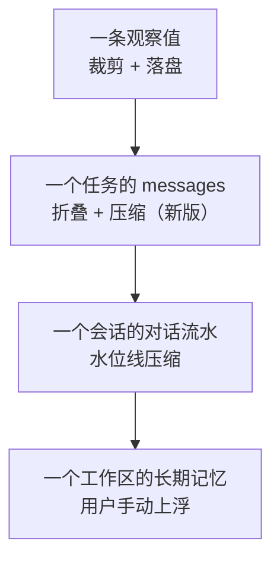

# 上下文工程

模型每次调用只能看到有限的上下文。本目录描述 BaseAgent 怎样决定"放什么进去、放不下时怎么办、哪些要长期记住"。

## 文档

| 文档 | 内容 | 状态 |
|---|---|---|
| [01_observation_governance.md](01_observation_governance.md) | 观察值治理：工具输出的裁剪、落盘与取回 | 已写初稿 |
| [02_window_and_compaction.md](02_window_and_compaction.md) | 窗口与压缩：会话级水位线压缩、任务级折叠与压缩 | 已写初稿 |
| [03_prompt_assembly.md](03_prompt_assembly.md) | 提示词装配：分层、顺序、缓存友好、检视 | 已写初稿 |
| [04_memory.md](04_memory.md) | 记忆：四层结构、存储、沉淀与投毒防护 | 已写初稿 |
| [05_inheritance.md](05_inheritance.md) | 上下文继承：什么跟着对话走、什么不走、折叠后留什么 | 已写初稿 |

## 四个时间尺度

| 尺度 | 控制手段 | 现状 |
|---|---|---|
| 单条观察值 | Token 阈值触发的摘要加落盘 | 已实现 |
| 单个任务 | 旧观察值折叠、任务内压缩、[继承规则](05_inheritance.md) | 折叠与任务内压缩已实现，继承规则部分未实现 |
| 单个会话 | 80% 触发、切出 40% 的滚动压缩 | 已实现，有若干问题 |
| 单个工作区 | 用户手动沉淀 | 已实现，仅手动 |

## 设计原则

1. **便宜的手段先用。** 裁剪、折叠不调用模型；只有它们不够时才压缩。
2. **能重得的不继承，会过期的不继承。** 读过的文件、跑过的命令输出折成存根，需要时再取；继承结论与指针，不继承原料，见 [上下文继承](05_inheritance.md)。
3. **全文放磁盘，摘要放上下文，并保证取得回来。** 不可重放的输出必须带句柄，见 [观察值治理 §6](01_observation_governance.md)。
4. **只操作完整的单元。** 对话以"问加答"为单元，工具往返以原子组为单元，永不在中间截断。
5. **视图与事实分离。** 折叠和压缩只改变发给模型的视图，不改写持久化的状态，原文始终可查。
6. **降级而不是失败。** 分词、压缩、装配的任一环节出问题，退化为更粗糙的方案并告警，任务继续。
7. **上下文即攻击面。** 进入上下文的一切都可能来自不可信来源，记忆也不例外，见 [记忆 §5.3](04_memory.md)。
8. **稳定在前，易变在后，新内容只追加。** 按共享范围从宽到窄排列（全局静态：系统层与工具 Schema → 工作区：技能清单、项目规则、工作区常量与记忆 → 会话：金丝雀、会话记忆、近期问答 → 任务：数据层、最新需求 → 追加式的任务内往返 → 尾部草稿回显），同时让开头放角色与安全协议、结尾放此刻要做的事，以顺应注意力的分布。折叠与压缩成批低频，每次都是一次已知的缓存失效，见 [提示词装配 §2、§5](03_prompt_assembly.md)。

## 代码定位与上下文工程

代码工程定位基于符号检索（`grep`、`rg`、`find`）与精确文件查阅（`view_file`），而非概率性向量检索：

- 搜索与测试结果主要以工具输出的形式进入上下文，因此观察值治理（Token 阈值裁剪与 `read_artifact` 回流）是控制上下文规模的核心保障。
- 系统提示词与内置技能引导模型优先通过精确符号定位与行级查阅理解代码，避免全量读入大文件。

