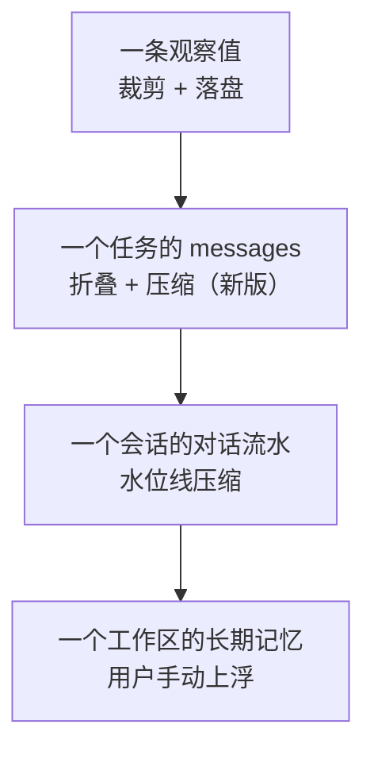

# 上下文工程

模型每次调用只能看到有限的上下文。本目录描述 Aegis 怎样决定"放什么进去、放不下时怎么办、哪些要长期记住"。

## 文档

| 文档 | 内容 | 状态 |
|---|---|---|
| [01_observation_governance.md](01_observation_governance.md) | 观察值治理：工具输出的裁剪、落盘与取回 | 已写初稿 |
| [02_window_and_compaction.md](02_window_and_compaction.md) | 窗口与压缩：会话级水位线压缩、任务级折叠与压缩 | 已写初稿 |
| [03_prompt_assembly.md](03_prompt_assembly.md) | 提示词装配：分层、顺序、缓存友好、检视 | 已写初稿 |
| [04_memory.md](04_memory.md) | 记忆：四层结构、存储、沉淀与投毒防护 | 已写初稿 |

## 四个时间尺度

| 尺度 | 控制手段 | 现状 |
|---|---|---|
| 单条观察值 | Token 阈值触发的摘要加落盘 | 已实现 |
| 单个任务 | 旧观察值折叠、任务内压缩 | **缺失**，新版新增 |
| 单个会话 | 80% 触发、切出 40% 的滚动压缩 | 已实现，有若干问题 |
| 单个工作区 | 用户手动沉淀 | 已实现，仅手动 |

## 设计原则

1. **便宜的手段先用。** 裁剪、折叠不调用模型；只有它们不够时才压缩。
2. **全文放磁盘，摘要放上下文，并保证取得回来。** 目前取不回来，见 [观察值治理 §6](01_observation_governance.md)。
3. **只操作完整的单元。** 对话以"问加答"为单元，工具往返以原子组为单元，永不在中间截断。
4. **视图与事实分离。** 折叠和压缩只改变发给模型的视图，不改写持久化的状态，原文始终可查。
5. **降级而不是失败。** 分词、压缩、装配的任一环节出问题，退化为更粗糙的方案并告警，任务继续。
6. **上下文即攻击面。** 进入上下文的一切都可能来自不可信来源，记忆也不例外，见 [记忆 §5.3](04_memory.md)。
7. **稳定在前，易变在后，新内容只追加。** 固定前缀（系统层、项目规则槽、工作区常量）永不压缩、逐字节稳定；其后依次是对话记忆、任务开始时确定的数据层、最新需求、追加式的任务内往返、尾部的阶段指令。折叠与压缩成批低频，每次都是一次已知的缓存失效，见 [提示词装配 §2、§5](03_prompt_assembly.md)。

## 与现状的主要差异

读代码时发现的、新版需要处理的问题，集中列在这里：

| # | 问题 | 位置 | 级别 |
|---|---|---|---|
| 1 | 任务内 `messages` 无窗口、无压缩，全量重发 | [窗口 §3](02_window_and_compaction.md) | 高 |
| 2 | 被裁剪的观察值模型取不回（`artifact://` 句柄无人解析） | [观察值 §6](01_observation_governance.md) | 高 |
| 3 | 任务内的事实与失败尝试不写回会话记忆 | [记忆 §5](04_memory.md) | 高 |
| 4 | 记忆放在系统提示词里，存在投毒通路 | [记忆 §5.3](04_memory.md) | 高 |
| 5 | evaluator 覆盖继承来的历史摘要 | [窗口 §3.3](02_window_and_compaction.md) | 中 |
| 6 | 记忆事实与失败尝试只追加不收敛，无上限 | [窗口 §2](02_window_and_compaction.md) | 中 |
| 7 | 压缩器绕过模型网关，无降级、无重试；压缩阻塞任务结束事件 | [窗口 §2](02_window_and_compaction.md) | 中 |
| 8 | 项目规则无信任开关、无长度上限 | [装配 §4](03_prompt_assembly.md) | 中 |
| 9 | `compaction_trigger_turns` 配置无效 | [窗口 §2](02_window_and_compaction.md) | 低 |
| 10 | 读取不存在的工作区时用虚构路径兜底 | [记忆 §3](04_memory.md) | 低 |
| 11 | 产物无清理机制 | [观察值 §9](01_observation_governance.md) | 低 |
| 12 | 阶段指令放在系统消息里，使各阶段请求的首条消息不同，无法共享前缀缓存；工具与技能清单排在易变的会话层之后 | [装配 §3.7、§5](03_prompt_assembly.md) | 中 |

第 1 到第 4 项建议在实现新版时最先处理。

## 去掉 RAG 之后

旧版里"代码定位"靠检索服务；去掉之后，`rag_search` 与代码检索子智能体消失，模型靠 `bash`（grep、rg、find）和 `view_file` 定位代码。这对上下文工程有两点影响：

- 搜索结果会更多地以 `bash` 输出的形式进入上下文，观察值裁剪与 `read_artifact` 变得更重要。
- 系统提示词和技能里关于"先用 `rag_search` 核实"的措辞需要改成"先用 `grep`、`view_file` 核实"。
