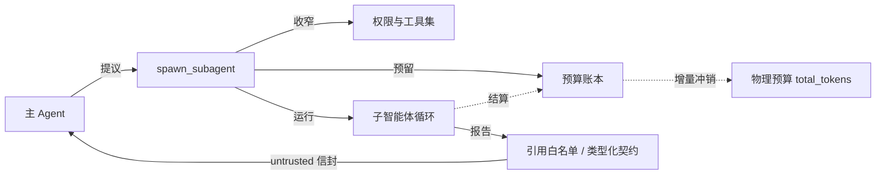

# 子智能体

子智能体是运行在**独立上下文**里的有界执行体。主 Agent 把子任务交给它，只收回一份结构化结论，中间产生的大量观察值不会进入主上下文。

Aegis 里有两种子智能体，目的不同，隔离方式也不同。

## 文档

| 文档 | 内容 | 状态 |
|---|---|---|
| [01_research_isolation.md](01_research_isolation.md) | 研究隔离区：唯一的外部信息入口，特权分离与强类型报告 | 已写初稿 |
| [02_dynamic_delegation.md](02_dynamic_delegation.md) | 动态委派：能力衰减、越级即失败、引用白名单 | 已写初稿 |
| [03_budget_ledger.md](03_budget_ledger.md) | 预算账本：预留、结算与守恒 | 已写初稿 |

## 两种子智能体

| | 研究子智能体 | 动态子智能体 |
|---|---|---|
| 入口工具 | `delegate_research` | `spawn_subagent` |
| 目的 | **安全**：隔离不可信的外部内容 | **效率**：隔离大量中间观察值 |
| 工具集 | 固定，只有 `web_search` | 每次由主 Agent 提议，经父表收窄 |
| 本地权限 | 无 | 不高于父级，且不能请求审批 |
| 回流形态 | `ResearchReport`，代码模板渲染 | `SubagentReport`，引用白名单校验 |
| 回流信任级 | 报告自带 `untrusted` 信封 | 返回时覆盖为 `untrusted` |
| 能力是否可变 | 否 | 是，但只降不升 |

> 旧版还有第三种，代码检索子智能体，它是对 RAG 的多轮检索封装，随 RAG 一起移除。

## 共同的设计要点

1. **中间内容不离开一次函数调用。** 子智能体用自己的消息列表，循环结束即丢弃；不写入 `AgentState`，不进检查点。图引擎时代这靠"不用子图"保证，新版没有图引擎，规则不变。
2. **回流的只有强类型报告。** 报告由代码模板渲染，不透传子模型原话；引用必须落在白名单内。
3. **有界。** 步数、Token、挂钟三重封顶，并且各自带一个比外层超时略小的内部预算，让内部先收尾，而不是被取消。
4. **失败不抛异常。** 任何阶段出问题都降级为带 `warnings` 的报告，绝不把异常或中间观察值透传给主 Agent。
5. **用量由框架读取，不信自述。** 子智能体在文本里声称花了多少都不算数。

## 与权限、信任、预算的关系

- 权限收窄见 [权限分层 §7](../05_security/01_permission_tiers.md)。
- 回流内容的信任处理见 [信任与注入 §3](../05_security/03_trust_and_injection.md)。
- 预算对账见 [预算账本](03_budget_ledger.md)。

## 已发现的问题汇总

| # | 问题 | 位置 | 级别 |
|---|---|---|---|
| 1 | 研究子智能体不经账本，消耗不计入父任务预算，且无调用次数上限，可绕过熔断 | [账本 §7](03_budget_ledger.md)、[研究 §8](01_research_isolation.md) | **高** |
| 2 | 研究报告正文未转义，可提前闭合信封 | [研究 §8](01_research_isolation.md) | 高 |
| 3 | 第二次派发起账本重复扣减子级消耗 | [账本 §7](03_budget_ledger.md) | 中 |
| 4 | 引用白名单把失败的调用也算作已访问 | [委派 §8](02_dynamic_delegation.md) | 中 |
| 5 | 子级内部调用不进入轨迹，审计缺口 | [委派 §8](02_dynamic_delegation.md) | 中 |
| 6 | 子级没有金丝雀检查 | [委派 §8](02_dynamic_delegation.md) | 中 |
| 7 | 研究证据正文进入子模型提示词时没有信封 | [研究 §8](01_research_isolation.md) | 中 |
| 8 | `max_sources` 不收敛、派发次数续跑后重置、子级与父级共享工具实例 | 各文档 | 低 |

第 1 项建议在实现新版时最先处理。它让物理预算形同虚设，且不需要攻击者参与，模型自己多调几次研究就会发生。

## 去掉 RAG 之后

- 代码检索子智能体删除，`denied_tools` 中的 `delegate_code_search` 一并去掉。
- 读代码的需求由主 Agent 用 `bash`（grep、rg）和 `view_file` 承担。需要大量阅读而只回流结论的场景，正好适合 `spawn_subagent`，授予 `bash` 与 `view_file`，让它在独立上下文里搜索与阅读，只带回带引用的结论。系统提示词里"何时值得委派"的描述应据此调整。
