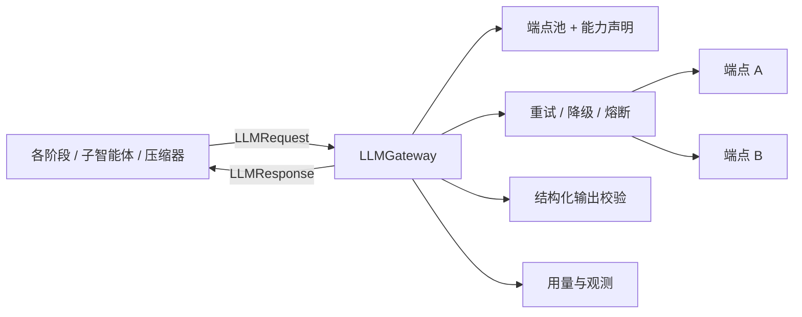

# LLM 网关

模型调用的唯一入口。去掉 LangChain 之后，只有这一层接触模型 SDK：它把自定义的 `Message` 转成线上协议，把响应转回来，并负责分档、降级、重试、用量、结构化输出和思考内容。

## 文档

| 文档 | 内容 | 状态 |
|---|---|---|
| [01_gateway.md](01_gateway.md) | 两档模型、端点与能力声明、重试与降级、熔断、截止时间、用量、工具调用规范化 | 已写初稿 |
| [02_structured_output.md](02_structured_output.md) | 三层保证：请求路径选择、Pydantic 校验、修复重试；统一的降级路径 | 已写初稿 |
| [03_reasoning_content.md](03_reasoning_content.md) | 思考内容的提取、存储、回传策略、与降级的交互、安全 | 已写初稿 |
| [04_deepseek.md](04_deepseek.md) | 接入 DeepSeek：两档配置、思考开关与回传规则、JSON 模式、缓存字段、上线前验证清单 | 已写初稿 |

## 职责边界



| 网关负责 | 网关不负责 |
|---|---|
| 选档、选端点、构造线上请求 | 决定提示词内容（属于 [提示词装配](../03_context/03_prompt_assembly.md)） |
| 重试、降级、熔断、截止时间 | 决定任务是否继续（属于主循环与预算守卫） |
| 校验结构化输出并做一次修复重试 | 决定校验失败后业务上怎么办（由场景契约声明降级方式） |
| 用量计量（含估算）与调用观测 | 预算的累加与熔断（属于 [预算守卫](../02_runtime/02_main_loop.md) 与 [账本](../06_subagents/03_budget_ledger.md)） |
| 思考内容的提取与回传 | 思考内容的展示（前端）与安全扫描（属于 [安全](../05_security/)） |

## 设计原则

1. **调用方只说意图，不说端点。** 阶段代码只写档位、消息、工具和期望的输出类型。
2. **能力声明代替猜测。** "OpenAI 兼容"只保证线路格式，不保证能力。每个端点显式声明支持什么，网关据此决定发什么、不发什么。
3. **失败有层次。** 端点内重试，再端点间降级，再熔断记忆，最后才是任务级失败，且失败原因可区分。
4. **每次调用都有上界。** 截止时间贯穿重试与降级，任何一次调用都不会超过调用方给的时间。
5. **用量永远有数。** 缺少服务商用量时用保守估算并标记，预算不因端点特性而失效。
6. **格式问题先修复再降级。** 结构化输出失败时带着错误让模型重试一次，而不是直接吞掉。
7. **模型私有的状态不跨模型。** 思考内容的不透明载荷只回传给产生它的模型。

## 现状的主要问题

读代码时发现的，新版需要处理：

| # | 问题 | 位置 | 级别 |
|---|---|---|---|
| 1 | 响应不带 `usage` 时记为 0，Token 预算对这类端点失效 | [网关 §8](01_gateway.md) | 高 |
| 2 | 一次调用的总耗时无上界，可远超任务挂钟预算 | [网关 §6](01_gateway.md) | 高 |
| 3 | 思考内容被静默丢弃，也不可配置回传；换成会返回思考内容的模型就会出问题 | [思考内容 §1](03_reasoning_content.md) | 高 |
| 4 | 金丝雀检测不覆盖思考内容 | [思考内容 §10](03_reasoning_content.md) | 中 |
| 5 | 每次尝试新建客户端且不关闭 | [网关 §11](01_gateway.md) | 中 |
| 6 | 无熔断；记忆压缩绕过网关 | [网关 §5.4](01_gateway.md) | 中 |
| 7 | 结构化输出依赖字段别名表和各节点自己的兜底，契约没有唯一定义 | [结构化输出 §2](02_structured_output.md) | 中 |
| 8 | 工具参数非法 JSON 时静默当作普通参数；`length` 截断未处理 | [网关 §9](01_gateway.md) | 中 |
| 9 | 退避无抖动无上限；温度等参数无法按端点关闭 | [网关 §4、§5](01_gateway.md) | 低 |
| 10 | 三个阶段复制了事件发射代码并硬编码模型名 | [网关 §12](01_gateway.md) | 低 |

第 1 到第 3 项建议在实现新版时最先处理。

## 配置总览

```toml
[runtime.retry]
max_retries = 3
backoff_factor = 2.0
backoff_max_sec = 30          # 新增
circuit_open_after = 2        # 新增：连续耗尽几次后熔断
circuit_open_sec = 60         # 新增

[models.reasoning]
temperature = 0.0
[[models.reasoning.endpoints]]
# name / base_url / model / api_key_env / timeout_sec
# context_window / max_output_tokens / temperature / reasoning_effort   新增
[models.reasoning.endpoints.capabilities]
# tools / parallel_tools / json_object / json_schema / usage_in_response
# reasoning_field / reasoning_passback

[structured]
repair_retries = 1
prefer_schema = true
on_truncate_raise_max_tokens = true
```

## 相关决策

[0003 思考内容默认不回传，按端点显式开启](../12_decisions/0003-reasoning-passback-default.md)（已采纳）。本目录的设计以它为前提；日后推翻，需同步修订 [思考内容](03_reasoning_content.md) 与 [状态模型](../02_runtime/01_state_model.md)。
