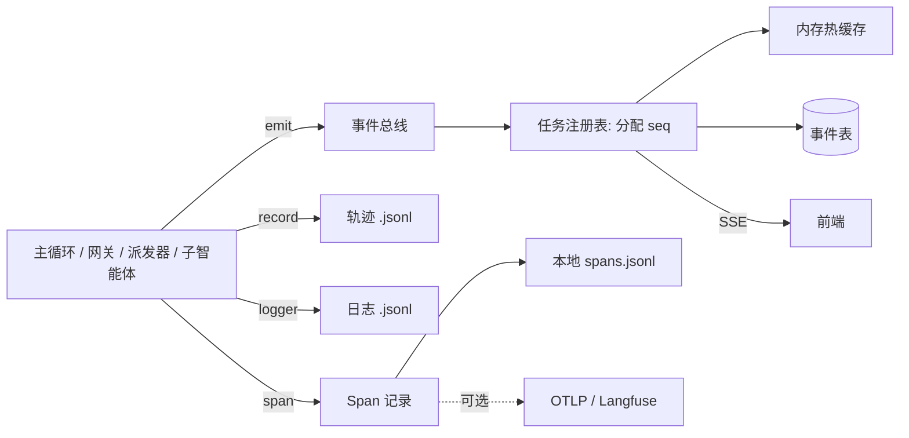

# 可观测性

运行时需要同时回答四类问题，对应四条互不依赖的旁路：

| 问题 | 载体 | 文档 |
|---|---|---|
| 现在进行到哪了？ | **事件**：实时推给前端的 SSE 流 | [01_events.md](01_events.md) |
| 它到底做了什么？ | **轨迹**：每步的因果记录，审计与评测的数据源 | [02_trajectory_and_logs.md](02_trajectory_and_logs.md) |
| 运行时内部发生了什么？ | **日志**：结构化 JSONL，供开发者排障 | [02_trajectory_and_logs.md](02_trajectory_and_logs.md) |
| 时间花在哪、调用树什么样？ | **追踪**：用 span 把以上三者关联起来 | [03_tracing.md](03_tracing.md) |

## 文档

| 文档 | 内容 | 状态 |
|---|---|---|
| [01_events.md](01_events.md) | 事件信封与目录、事件总线、SSE 传输、持久化与保留、脱敏 | 已写初稿 |
| [02_trajectory_and_logs.md](02_trajectory_and_logs.md) | 轨迹契约、日志装配、脱敏、三者的关系 | 已写初稿 |
| [03_tracing.md](03_tracing.md) | span 模型、导出器、隐私规则，以及外部追踪的接入方式 | 已写初稿 |

## 总原则

1. **全部是旁路。** 事件发不出去、轨迹写不进去、追踪导出失败，任务照常进行。任何观测组件都不得抛异常到主流程。
2. **观测不放宽隔离。** websearch 工具的页面正文不进入事件、轨迹、追踪，只有限长的摘要。可观测性不能成为原始不可信内容外泄的通道。
3. **默认不出本机。** 所有远程导出默认关闭；内容导出再单独关闭。
4. **统一脱敏，只实现一次。** 事件、轨迹、日志、追踪共用同一个脱敏函数。
5. **用关联键连接，不互相依赖。** `task_id`、`span_id` 把四条旁路串起来，但任何一条挂了不影响其他。
6. **审计数据优先于性能。** 轨迹逐条落盘，宁可多一次系统调用，也不丢已完成的步骤。

## 数据流

## 现状发现的问题

| # | 问题 | 位置 | 级别 |
|---|---|---|---|
| 1 | 轨迹从未记录 `tool_args`，看不到执行了什么命令 | [轨迹 §1.2](02_trajectory_and_logs.md) | **高** |
| 2 | 子智能体内部的调用没有进入轨迹，事件也不落盘 | [轨迹 §1.2](02_trajectory_and_logs.md) | 高 |
| 3 | 事件与任务句柄只在内存里，重启后时间线、检视器全部丢失 | [事件 §5.1](01_events.md) | 高 |
| 4 | `llm.call` 事件携带完整提示词，一条数百 KB，占满按条数限制的缓冲 | [事件 §5.1](01_events.md) | 中 |
| 5 | 慢消费者的事件被静默丢弃，订阅者不知情 | [事件 §5.1](01_events.md) | 中 |
| 6 | Langfuse 集成是未被调用的死代码，却占着默认依赖 | [追踪 §1](03_tracing.md) | 中 |
| 7 | 日志与任务无关联，sidecar 与 Agent 的日志无法串联 | [轨迹与日志 §2.1](02_trajectory_and_logs.md) | 中 |
| 8 | 脱敏函数不存在；事件、轨迹、日志都可能含密钥与命令 | [事件 §7](01_events.md) | 中 |
| 9 | 轨迹与事件没有保留策略，磁盘持续增长 | 各文档 | 低 |

第 1 到第 3 项建议在实现新版时最先处理，它们直接决定出了问题能不能查。

## 相关决策

[0004 追踪采用内部 span 模型加可插拔导出，移除 LangChain 回调式集成](../12_decisions/0004-tracing-model.md)（已采纳）。本目录的设计以它为前提；日后推翻，需同步修订 [追踪](03_tracing.md) 与依赖声明。
