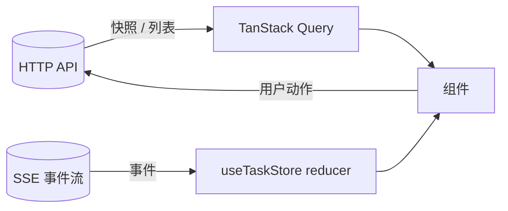

# 前端架构

## 1. 定位

控制台是**用户和 Agent 之间唯一的界面**。它要做好三件事：

1. 让用户看清 Agent 在做什么（进度、工具调用、子智能体、模型调用）。
2. 让用户在关键时刻做决定（审批越级操作），并且**看得懂自己在批准什么**。
3. 让用户管理工作区、会话、记忆、文件产物。

前端不做任何编排决策，也不持有任何业务事实的权威副本：事实在服务端，前端是投影。

## 2. 技术栈

| 项 | 选择 | 说明 |
|---|---|---|
| 框架 | React 19 + TypeScript | |
| 构建 | Vite 6，开发服务器监听 `127.0.0.1:5173` | 同源代理 `/api`、`/docs`、`/openapi.json` 到 `127.0.0.1:8000` |
| 样式 | Tailwind CSS 3 | |
| 状态 | Zustand（任务、工作区、界面三个 store） | |
| 服务端缓存 | TanStack Query | |
| SSE | `@microsoft/fetch-event-source` | 支持自定义请求头与重连 |
| Markdown | `react-markdown` + `remark-gfm` + `rehype-highlight` | |
| 编辑器 | Monaco | 文件查看与编辑 |
| 布局 | `react-resizable-panels` | |
| 测试 | Vitest + Testing Library + jsdom | |

## 3. 目录结构

```
src/
├── api/          HTTP 客户端、SSE 订阅、按资源划分的 API 模块
├── stores/       useTaskStore（≈800 行）、useWorkspaceStore、useUiStore
├── types/        与后端 DTO 对应的类型
├── components/
│   ├── layout/   AppLayout、AppHeader、StatusBar
│   ├── sidebar/  Sidebar、ProjectsTree、WorkspaceTree、SessionList
│   ├── chat/     ChatPane、MessageBubble、InputConsole、TraceTimeline、
│   │             HitlApprovalCard、SubagentReportCard、LlmInvocationInspector
│   ├── canvas/   CanvasPane、TabBar、MarkdownReader（文件与产物查看）
│   ├── drawer/   ContextDrawer（上下文检视）、MemoryDrawer
│   ├── modals/   WorkspaceModal、SettingsModal
│   ├── domain/   MilestoneItem、WaterLevelMeter、FileMutationCard、…
│   ├── common/   DirectoryPickerModal、Logo、Avatar
│   └── ui/       Button、Modal、Drawer、Tabs、Badge、CodeBlock
└── utils/、test/
```

去掉 RAG 后删除：`RagCenterModal`、`useRagStore`、`rag.api.ts`、`CitationBadge` 中针对 RAG 切片的部分、`SidecarStatusPill` 中的 RAG 项、`types` 里的 RAG 类型，以及各处的 RAG 状态展示（`AppHeader`、`StatusBar`、`InputConsole`、`MemoryDrawer`、`SettingsModal`、`SubagentReportCard`、`DirectoryPickerModal`、`WorkspaceTree`、`AppLayout`）。

## 4. 界面布局

```
┌ AppHeader：工作区切换、模型与权限基线、系统状态 ───────────────┐
├──────────┬──────────────────────────────┬──────────────────────┤
│ Sidebar  │ ChatPane                     │ CanvasPane           │
│ 工作区树  │ 消息、阶段时间线、审批卡片、   │ 文件 / 产物 / 报告    │
│ 会话列表  │ 子智能体报告、调用检视         │ 多标签               │
│          ├──────────────────────────────┤                      │
│          │ InputConsole：输入、权限选择   │                      │
├──────────┴──────────────────────────────┴──────────────────────┤
│ StatusBar：任务状态、步数、Token、水位                           │
└────────────────────────────────────────────────────────────────┘
        ContextDrawer / MemoryDrawer 从侧边滑出
```

## 5. 数据流



- **快照用请求，进度用事件。** 工作区、会话、记忆、文件树这类查询走 HTTP 与缓存；任务执行中的变化走 SSE，在 `useTaskStore` 里按事件类型归约成界面状态。
- 事件到状态的映射在一个集中的归约函数里（按事件名分支）。新增事件在这里加一个分支。

### 5.1 事件归约

`useTaskStore` 处理的事件：`task.started`、`plan`、`node.finished`、`node.started`、`tool.call`、`tool.result`、`task.waiting_for_approval`、`task.approved`、`task.rejected`、`llm.call`、`task.finished`、`task.error`，以及子智能体与研究事件。契约见 [09_api/02](../09_api/02_events_contract.md)。

## 6. 关键界面

| 界面 | 职责 | 要点 |
|---|---|---|
| 阶段时间线 `TraceTimeline` | 展示里程碑与各阶段结论、工具调用往返 | 按阶段序号归组，用 `node.finished` 的阶段序号而不是事件条数估计进度 |
| 审批卡片 `HitlApprovalCard` | 展示越级动作并收集决策 | 见 [02](02_approval_and_safety_ux.md) |
| 子智能体卡片 | 展示委派的角色、步骤、被拒绝的越级尝试、结论与引用 | `subagent.blocked` 要突出；未经验证的结论要标注 |
| 调用检视器 `LlmInvocationInspector` | 查看每次模型调用的消息体、工具、响应、耗时、Token | 按需拉取完整内容；展示前对金丝雀脱敏；折叠思考内容 |
| 上下文抽屉 | 展示模型此刻看到的各层 | 每层 Token 估算、是否被截断，见 [提示词装配 §6](../03_context/03_prompt_assembly.md) |
| 记忆抽屉 | 查看与管理工作区与会话记忆 | 可删除条目，标明来源，见 [记忆 §5](../03_context/04_memory.md) |
| 画布 | 查看文件、产物、研究报告 | Markdown 与代码高亮；文件编辑带冲突检测 |
| 状态栏 | 状态、步数、累计 Token、预算水位 | 预算接近上限时提示 |

## 7. 现状发现的问题

读前端代码与后端契约对照，发现下列不一致与缺口：

| # | 问题 | 级别 |
|---|---|---|
| 1 | **前端解析不了后端的错误体。** 后端返回 `{ "error": { "code", "message", "details", "trace_id" } }`，前端的 `HttpClient` 只认 `{detail: …}`（FastAPI 默认形状）或顶层 `message`，字段名也对不上（`error_code`、`context`）。结果是服务端精心设计的错误信息到了用户这里只剩 "API Request Failed [409] Conflict" | 高 |
| 2 | **SSE 断开后不重连。** 订阅封装的 `onerror` 里重新抛出了异常，库的约定是抛出即停止重试。网络抖动、服务重启都会让事件流永久中断，界面停在旧状态，用户并不知情 | 高 |
| 3 | **没有序号连续性检查，也没有 `STREAM_GAP` 处理。** 即便重连成功，也无法发现丢了事件 | 中 |
| 4 | **令牌同时放在请求头和 URL 查询参数里。** SSE 的 URL 上带着 `?token=`，会进入后端访问日志、浏览器历史。而 `fetch-event-source` 本身支持自定义头，查询参数是多余的。令牌还存放在 `localStorage`，任何同源脚本都可读 | 中 |
| 5 | **`llm.call` 事件整体进入 store。** 事件内联完整提示词，长任务里会积累大量内存，且这些数据只在打开检视器时才需要 | 中 |
| 6 | **`useTaskStore` 近 800 行**，混合事件归约、任务提交、审批、取消、估算。难以测试和演进 | 低 |
| 7 | 任务与事件只在内存。刷新页面后当前任务的界面状态丢失，因为没有任务列表接口可用于恢复 | 中 |
| 8 | 上下文 Token 的估算在前端用固定常数（系统提示词约 1200、每条记忆 60），与后端实际装配结果不一致，应该直接用后端的检视接口给出的数 | 低 |
| 9 | 构建只有开发服务器的配置，没有生产形态的服务方案（谁来托管静态文件、如何与 API 同源） | 低 |

## 8. 新版设计要点

1. **统一的请求封装**：解析 `{error:{…}}` 信封，`ApiError` 暴露 `code`、`message`、`details`、`traceId`；界面错误提示展示 `message` 并提供"复制 trace_id"。
2. **SSE 管理器**：独立模块，负责订阅、重连（指数退避，上限 30 秒）、`Last-Event-ID`、序号连续性检测、`STREAM_GAP` 与 `stream.dropped` 的处理、终态后停止。对外只暴露一个事件回调与连接状态。界面显示连接状态（已连接、重连中、已断开），断开时有明确提示，而不是静默。
3. **令牌**：优先走同源代理注入，浏览器不持有令牌；不做代理时用请求头，**去掉 URL 查询参数**。`localStorage` 改为内存加可选的会话存储，并在界面说明风险。见 [09_api/03 §3](../09_api/03_access_and_errors.md)。
4. **按需加载重内容**：`llm.call` 事件只存摘要，完整内容在打开检视器时拉取。
5. **拆分 store**：事件归约单独成纯函数（`reduceTaskEvent(state, event)`），与存储解耦，可以用事件序列快照直接测试。
6. **状态恢复**：页面加载时调用会话任务列表与任务快照恢复当前任务；若任务仍在运行，从快照的最新序号重新订阅。
7. **后端为准**：所有预算、上下文规模、状态都取自后端字段，不在前端估算。

## 9. 不变量

1. 前端不持有任何业务事实的权威副本，刷新后可从后端恢复。
2. 渲染来自 Agent 的内容时不使用 `dangerouslySetInnerHTML`，Markdown 不启用原始 HTML。
3. 令牌不出现在 URL。
4. 事件流断开对用户可见。
5. 每个来自服务端的错误都展示其 `message`，并能拿到 `trace_id`。
6. 重内容（完整提示词、大产物）按需加载。

## 10. 测试要点

- 归约函数：用录制的事件序列回放，断言最终状态；覆盖乱序、重复、未知事件、缺字段。
- SSE 管理器：断线重连带正确的 `Last-Event-ID`；序号缺口触发重连；`STREAM_GAP` 触发快照同步；终态后不再重连；退避上限。
- 错误：各类状态码的信封解析；非 JSON 响应体的回退。
- 组件：审批卡片、时间线、子智能体卡片、检视器的渲染与交互。
- 安全：含 `<script>`、内联事件、`javascript:` 链接的 Markdown 不被执行。
- 恢复：刷新后恢复运行中的任务。

## 11. 待定

- 是否把前端打包进后端静态托管，成为单进程分发。这会简化令牌与同源问题，也让"一键启动"更干净。
- 是否支持多任务并排查看（服务端目前默认单任务并发）。
- 国际化。界面文案目前是中英混杂的硬编码，若要面向更多用户需要抽取。
