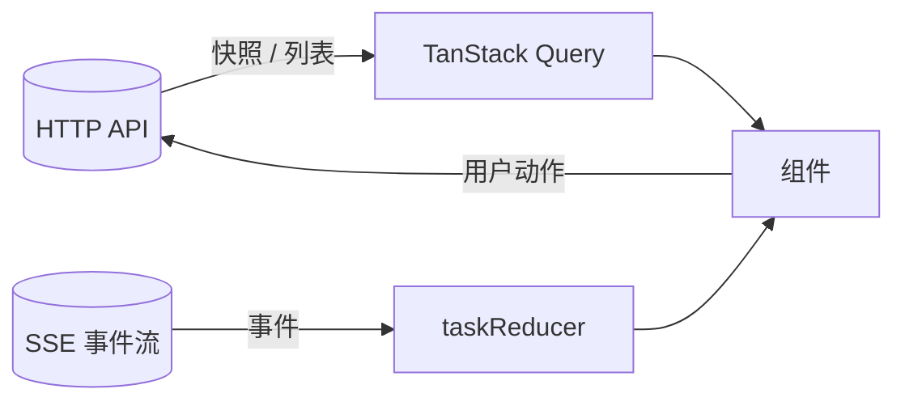

# 前端架构

## 1. 定位

控制台是**用户和 Agent 之间唯一的界面**。它要做好三件事：

1. 让用户看清 Agent 在做什么（进度、工具调用、子智能体、模型调用）。
2. 让用户在关键时刻做决定（审批越级操作），并且**看得懂自己在批准什么**。
3. 让用户管理工作区、会话、记忆、文件产物。

前端不做任何编排决策，也不持有任何业务事实的权威副本：事实在服务端，前端是投影。

## 2. 技术栈

| 项 | 选择 | 说明 |
|---|---|---|
| 框架 | React 19 + TypeScript | |
| 构建 | Vite 6，开发服务器监听 `127.0.0.1:5173` | 同源代理 `/api`、`/docs`、`/openapi.json` 到 `127.0.0.1:11328` |
| 样式 | Tailwind CSS 3 | 颜色全部来自 CSS 变量，明暗主题只切换变量 |
| 路由 | `@tanstack/react-router` | URL 是可恢复的界面状态：工作区、会话、`?task`、设置分区 |
| 状态 | Zustand（当前任务、队列、待生效、界面偏好） | 队列与偏好存 `localStorage`；业务事实不落在前端 |
| 服务端缓存 | TanStack Query | 同一份数据在侧栏、对话、检视器、设置间共享 |
| SSE | 自写的 fetch 流式管理器（`api/sse.ts`） | 自定义请求头、指数退避重连、序号缺口检测、瞬态增量 |
| Markdown | `react-markdown` + `remark-gfm` + `rehype-highlight` | 不启用原始 HTML |
| 动效 | `motion` | 侧栏、检视器、气泡与弹层 |
| 测试 | Vitest + Testing Library + jsdom | 暂无 E2E |

## 3. 目录结构

```
src/
├── app/          router.tsx（路由树）、Shell.tsx（外壳、快捷键、提示条）、Home.tsx（根路径去向）
├── api/          http.ts（请求封装与错误信封）、sse.ts（SSE 管理器）、endpoints.ts（按资源划分）、
│                 queries.ts（会话活动与标题）、useSettings.ts（模型、会话设置、上下文快照）
├── stores/       taskReducer.ts（事件归约，纯函数）、useAppStore.ts（当前任务、连接、提示）、
│                 useQueueStore.ts（排队）、usePendingStore.ts（待生效计数）、useUiStore.ts（界面偏好）
├── types/        与后端 DTO 对应的类型
├── components/
│   ├── common/   SafeMarkdown、DirectoryPicker
│   ├── domain/   HitlApprovalCard（审批）、McpStatus（顶栏在线数）
│   ├── layout/   ThemeToggle
│   ├── modals/   WorkspaceModal、RenameWorkspaceModal、ConfirmDialog
│   ├── icons/    Glyphs
│   └── ui/       Select、Slider、Toggle、Checkbox、MoreMenu、Tooltip、InlineEdit、StatusDot、CopyButton、primitives
├── features/
│   ├── sidebar/      Sidebar（工作区 → 会话、待办、搜索）
│   ├── workspace/    WorkspacePage（概览、设置、记忆、目录树）
│   ├── conversation/ ConversationPage、Composer、RunView、useReplay、
│   │                 blocks/{ReasoningBlock,SayBlock,ToolCard,AgentGroup}
│   ├── inspector/    Inspector、TaskCard、ContextCard
│   └── settings/     SettingsPage、parts、sections/{General,Models,Prompts,Skills,Mcp,Tools,Diagnostics}
└── utils/、test/
```

组件职责与后端降级矩阵见 [04_redesign.md](04_redesign.md) §8、§13。

## 4. 界面布局

```
┌────────────┬───────────────────────────────────────────┬─────────────┐
│ 侧栏        │ 主区（路由决定）                            │ 检视器       │
│ 工作区→会话  │  /w/:wid/s/:sid   对话 + 输入台             │ 任务         │
│ 待办 / 搜索  │  /w/:wid          工作区概览                │ 上下文       │
│ 底部设置     │  /settings/...    全屏设置                  │ （可折叠）    │
└────────────┴───────────────────────────────────────────┴─────────────┘
```

- 每个主页面自带顶栏（面包屑、状态、检视器开关），没有全局 TopBar；更少的层级，更多内容宽度。
- 宽度不足以放下检视器时改为右侧抽屉；手机宽度下侧栏也变成左侧抽屉，输入台贴底并留出安全区。
- 卡片、弹窗、下拉、气泡都按层级令牌分层（`sticky < drawer < modal < pop < tip < toast`），并渲染到 `body`，不被祖先的 `overflow` 或 `backdrop-filter` 裁切。

## 5. 数据流



- **快照用请求，进度用事件。** 工作区、会话、记忆、文件树、设置这类查询走 HTTP 与缓存；任务执行中的变化走 SSE，在 `stores/taskReducer.ts` 里按事件类型归约成 `RunState`。
- URL 决定“看哪个工作区 / 会话 / 任务 / 设置分区”，不把导航状态塞进 store；`useUiStore` 只存侧栏、检视器、主题、思考链默认值这类纯界面偏好。
- 排队只存在于前端：`useQueueStore` 按会话保存消息，任务正常结束后由 `ConversationPage` 依次提交；失败 / 取消会暂停。

### 5.1 事件归约

`reduceTaskEvent` 处理的事件：`task.started`、`model.reply`、`plan.updated`、`turn.finished`、`context.compacted`、`tool.call`、`tool.result`、`task.waiting_for_approval`、`task.approved`、`task.rejected`、`llm.call`、`task.finished`、`task.error`，以及 `websearch.*`、`subagent.*`、`guard.*`。瞬态事件 `model.delta` 与 `tool.output` 不占序号，直接合并进正在流式的块；`model.reply` 到达后以权威内容覆盖。契约见 [09_api/02](../09_api/02_events_contract.md)。

## 6. 关键界面

| 界面 | 职责 | 要点 |
|---|---|---|
| 侧栏 `Sidebar` | 工作区 → 会话、待办、搜索、置顶 / 归档 / 重命名 / 分支 / 删除 | 状态点由最近任务决定；字段缺失时相关菜单项置灰 |
| 工作区 `WorkspacePage` | 信息、工作区级设置、记忆、只读目录树 | 目录树只读；记忆按四层分别增删 |
| 对话 `ConversationPage` | 消息流、运行块、审批、输入台、滚动跟随 | 事件块化渲染；历史任务可回放；`?task` 深链接 |
| 运行块 `RunView` | reasoning / say / tool / agent / decision / delivery | 相邻同类 agent 事件合并；终态显示回合、Token、用时与终止原因 |
| 思考 `ReasoningBlock` | 流式展开、完成折叠 | 纯文本；`thinking` 偏好控制展开 / 折叠 / 隐藏 |
| 工具 `ToolCard` | 按工具展开参数、命令、diff、输出、耗时、退出码、产物 | 长结果可加载完整产物；MCP 工具标注不可信来源 |
| 输入台 `Composer` | 输入、模型、权限、排队、压缩入口 | `full_permissions` 每次确认；运行中提交进可撤回队列 |
| 审批卡片 `HitlApprovalCard` | 展示越级动作并收集决策 | 见 [02](02_approval_and_safety_ux.md) |
| 检视器 `Inspector` | 任务卡、上下文占比卡 | 上下文数字取自后端 `/context`；任务卡含计划、产物、历史 |
| 设置 `SettingsPage` | 通用、模型、提示词、技能、MCP、工具、诊断 | 全屏页；每个写操作标明作用域与“下个任务生效” |
| 通用控件 | Select、Slider、Toggle、Checkbox、Tooltip、MoreMenu | 全部自绘并走 Portal；禁用态用 `aria-disabled`，气泡仍可用 |

## 7. 历史缺口与现状

重设计前读过一轮旧前端，下列问题多数已在新结构里解决；保留这张表是为了记住为什么改：

| # | 旧缺口 | 现状 |
|---|---|---|
| 1 | 解析不了后端 `{error:{code,message,details,trace_id}}` 信封 | 已解决：`ApiError` 带 `code`、`traceId`，提示条可复制 `trace_id` |
| 2 | SSE 断开不重连 | 已解决：指数退避、`Last-Event-ID`、终态停止 |
| 3 | 没有序号连续性检查与 `STREAM_GAP` 处理 | 已解决：缺口触发快照同步后重新订阅 |
| 4 | 令牌进 URL / `localStorage` | 已解决：同源代理在服务端注入，浏览器代码不持有令牌 |
| 5 | `llm.call` 整体进 store | 已解决：归约只推进序号，不进时间线 |
| 6 | 单个 store 近 800 行 | 已拆：`taskReducer` 纯函数 + 多个小 store |
| 7 | 刷新后任务状态丢失 | 已解决：任务列表 + 快照恢复，事件从头回放 |
| 8 | 上下文 Token 前端估算 | 已解决：一律取后端 `/context` |
| 9 | 没有生产形态静态托管 | 仍未做，见 §11 |

## 8. 设计要点（已落地）

1. **统一的请求封装**：解析 `{error:{…}}` 信封，`ApiError` 暴露 `code`、`message`、`details`、`traceId`；界面错误提示展示 `message` 并提供“复制 trace_id”。
2. **SSE 管理器**：独立模块，负责订阅、重连（指数退避，上限 30 秒）、`Last-Event-ID`、序号连续性检测、`STREAM_GAP` 与 `stream.dropped` 的处理、终态后停止。瞬态 `model.delta` / `tool.output` 单独交付，不参与连续性检查。
3. **令牌**：同源代理注入，浏览器不持有令牌，也不出现在 URL。
4. **按需加载重内容**：工具结果被截断时按 `artifact_id` 拉全文；提示词分段按需查看。
5. **拆分 store**：事件归约是纯函数 `reduceTaskEvent(state, event)`，与存储解耦，可用事件序列回放测试。
6. **状态恢复**：页面加载时按路由恢复工作区 / 会话 / 任务；运行中的任务从快照与事件库重建。
7. **后端为准**：所有用量、上下文规模、状态都取自后端字段，不在前端估算。
8. **URL 化**：工作区、会话、任务、设置分区都在地址里；`/` 回到最近位置。

## 9. 不变量

1. 前端不持有任何业务事实的权威副本，刷新后可从后端恢复。
2. 渲染来自 Agent 的内容时不使用 `dangerouslySetInnerHTML`，Markdown 不启用原始 HTML。
3. 令牌不出现在 URL。
4. 事件流断开对用户可见。
5. 每个来自服务端的错误都展示其 `message`，并能拿到 `trace_id`。
6. 重内容（完整提示词、大产物）按需加载。

## 10. 测试要点

- 归约函数：用录制的事件序列回放，断言最终状态；覆盖乱序、重复、未知事件、缺字段、流式增量与 `model.reply` 覆盖。
- SSE 管理器：断线重连带正确的 `Last-Event-ID`；序号缺口触发重连；`STREAM_GAP` 触发快照同步；终态后不再重连；退避上限。
- 错误：各类状态码的信封解析；非 JSON 响应体的回退。
- 组件：审批卡片、工具卡、选择器、菜单、检视器、设置的渲染与交互。
- 安全：含 `<script>`、内联事件、`javascript:` 链接的 Markdown 不被执行。
- 恢复：刷新后恢复运行中的任务与历史任务。

## 11. 待定

- 是否把前端打包进后端静态托管，成为单进程分发。这会简化令牌与同源问题，也让“一键启动”更干净。
- 是否支持多任务并排查看（服务端目前默认单任务并发）。
- 国际化。界面文案目前是中文硬编码；本轮已确定不预留多语言。

## 12. 实现状态

前端已按本文与 [04_redesign.md](04_redesign.md) 落地：路由、侧栏、工作区概览、对话块、工具卡、思考链、可撤回队列、任务卡 / 上下文卡、全屏设置（提示词 / 技能 / MCP / 工具 / 诊断）、自绘控件与响应式布局。所有需要后端新接口的功能按 04 §9 降级，缺接口时置灰并提示“后端未提供”，不会抛错或卡住。

**视觉层**按 [03_visual_design.md](03_visual_design.md)：浅色为默认、暗色可切换；图标为主、含义放悬停气泡；下拉 / 滑动条 / 开关 / 复选框 / 菜单 / 滚动条全部自绘；层级令牌统一管理遮挡关系。

**未做**：生产形态的静态托管（构建产物目前只由开发服务器的同源代理使用）；文件查看与编辑界面（只有只读目录树）；调用检视界面；前端 E2E；后端 §9 的高优先级缺口（G1 / G2 / G4 / G5 / G6 / G7）。
